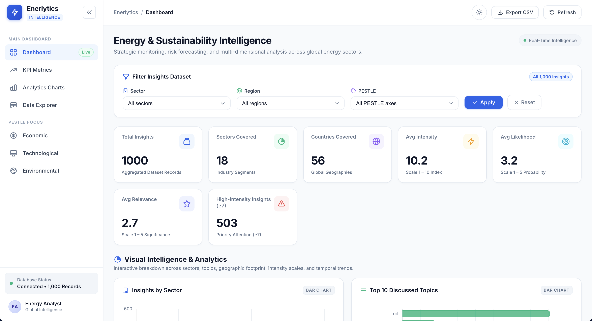
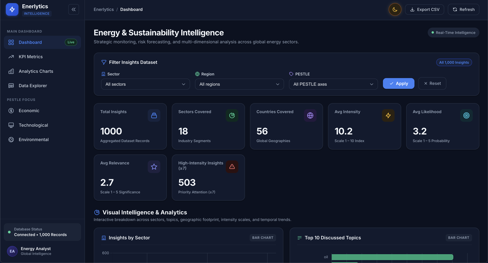

<div style="display: flex; align-items: center; justify-content: center; gap: 10px;">
    
    <h2 >Enerlytics - Global Energy & Sustainability Intelligence Dashboard</h2>
</div>

Enerlytics is a **web-based business intelligence dashboard project** that analyzes global energy and environmental insights across sectors, regions, and risk dimensions.

## Project Overview
This project focuses on:
- Energy and environmental trends
- Sector-wise and geographic intelligence
- Risk assessment using intensity and likelihood metrics
- PESTLE-based contextual analysis

The dashboard is designed as a **single-page BI view** with logical sections for fast insight consumption. All filtering, KPI recalculation, and chart re-rendering happen without a full page reload.

## Tools & Technologies

- **Backend:** Django (Python 3.14+)
- **Frontend:** Django Templates + HTMX (partial page swaps, no SPA framework)
- **Charts & Visualizations:** Chart.js
- **Database:** PostgreSQL 17 with pgvector (via Docker), with automatic SQLite fallback for local runs
- **Data Loading:** Django management command (`import_insights`) that cleans and loads `data/jsondata.json`
- **Styling / Performance:** WhiteNoise for static files, Gunicorn as the production server
- **Testing:** pytest + pytest-django
- **Deployment:** Docker & docker-compose

## Getting Started

### Option 1: Docker (recommended)
```bash
cp .env.example .env    # fill in Postgres credentials
docker compose up --build
```
The app runs at http://localhost:8000 and connects to the bundled `pgvector/pgvector:pg17` database service automatically.

### Option 2: Local development (SQLite fallback)
```bash
# create a virtual environment and install dependencies (uses pyproject.toml)
uv venv && uv sync
source .venv/bin/activate

python manage.py migrate
python manage.py import_insights   # clean + load data/jsondata.json
python manage.py runserver
```
Without a `DATABASE_URL`, Django falls back to the local `db.sqlite3`.

## Demo
| Light Mode | Dark Mode |
|------------|-----------|
|  |  |

## Dashboard Features

### Key Performance Indicators (KPIs)
- Total Insights
- Total Sectors Covered
- Total Countries Covered
- Average Intensity
- Average Likelihood
- High Impact Insights

### Sector & Topic Intelligence
- Insights by Sector
- Top Discussed Topics (Oil, Gas, Consumption, etc.)
- Sector vs Topic distribution

### Geographic Analysis
- Country-level insight distribution
- Region vs Sector comparison

### Risk & Impact Analysis
- Risk Matrix (Likelihood vs Intensity)
- Intensity distribution across insights
- Identification of high-impact, medium-likelihood issues

### PESTLE & Trend Analysis
- PESTLE category distribution
- Time-based trends using published dates

### Insight Explorer
- Detailed drill-down table
- Interactive HTMX filtering across all dimensions (filters are also reflected in the URL)

All aggregations are computed **server-side** in Django services; the frontend only draws the charts from injected JSON specs.

## Business Use Case

Enerlytics supports:
- **Business Intelligence & Reporting**
- **Strategic Planning**
- **Market & Sustainability Monitoring**
- **Executive Decision Support**

The dashboard helps stakeholders quickly understand **what is happening, where, and how impactful it is**.

## Dataset Description

The bundled dataset (`data/jsondata.json`) contains **1,000 curated energy/sustainability insights**. Each record includes:

- `title`, `insight`, `url` — the insight itself and its source link
- `sector`, `topic` — domain classification
- `country`, `region` — geographic attribution
- `intensity`, `likelihood`, `relevance`, `impact` — scoring metrics
- `pestle` — PESTLE category (Political, Economic, Social, Technological, Legal, Environmental)
- `source`, `added`, `published` — provenance and timeline
- `start_year`, `end_year` — projection horizon

The `import_insights` command normalizes the raw JSON before loading: it trims whitespace, converts `""` placeholders to NULLs, parses date strings, and discards out-of-range forecast years (2000–2100 window).

## Project Structure
```
enerlytics/
├── config/            # Django project settings & URLs
├── dashboard/         # Dashboard views, templates (HTMX partials), URLs
├── insights/          # Insight model, filtering/aggregation services,
│                      #   and the import_insights management command
├── ml/                # Placeholder app for upcoming ML/RAG features
├── data/              # Source dataset (jsondata.json)
├── static/            # CSS, Chart.js rendering logic, screenshots
├── templates/         # Base template (HTMX + Chart.js)
├── Dockerfile         # Production container build
└── docker-compose.yml # Web + Postgres (pgvector) services
```

## Testing
```bash
pytest
```

## Key Takeaways

- Energy sector dominates global insights
- Oil and gas remain primary focus topics
- Northern America is the most represented region
- Most insights fall into **medium-likelihood, high-impact** category
- Environmental risks are region-specific and supply-chain driven

---
